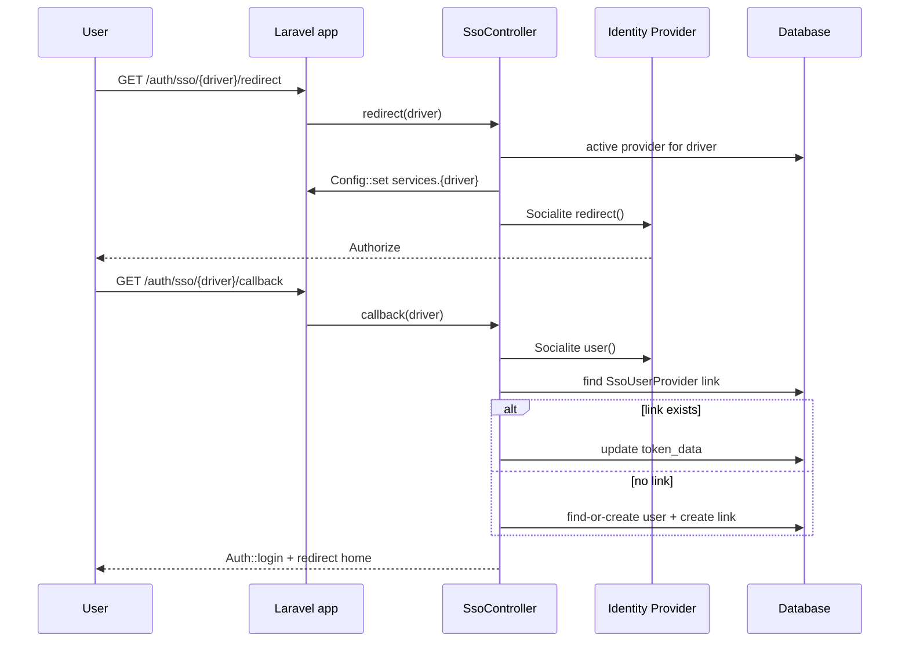

# Overview

## The core idea

OAuth/OIDC providers are **data, not config files**. Each provider (Google, GitHub, GitLab,
Bitbucket, Keycloak, Azure AD) is a row in `sso_providers` with an encrypted `client_secret` and a
JSON `config` column for driver-specific fields. There is no `.env` juggling and no redeploy to add,
edit, or disable a provider.

On login the controller swaps the runtime `services.{driver}` config from the database row, runs
Laravel Socialite, then finds-or-creates the local user and links the identity in
`sso_user_providers` (with encrypted `token_data`).

## Component map

| Concern | Class |
|---|---|
| Provider model | `Models\SsoProvider` — `HasUuid`, encrypted secret, `config` JSON, `active` scope, `toSocialiteConfig()` |
| Identity link | `Models\SsoUserProvider` — encrypted `token_data`, `user()` → configured user model |
| Auth flow | `Http\Controllers\SsoController` — `redirect()`, `callback()` (find-or-create + link) |
| Public API | `ConfigSso` + `Facades\ConfigSso` — `enabled()`, `providers()`, `drivers()`, `driverFields()` |
| Admin UI | `Livewire\SsoProviders` + `resources/views/livewire/sso-providers.blade.php` (Flux, opt-in) |
| Login buttons | `View\Components\Sso` → `resources/views/components/sso.blade.php` → `<x-sso />` (Flux-free) |
| Wiring | `ConfigSsoServiceProvider` (config, views, routes, migrations, Socialite drivers, Livewire, install command) |

## Request lifecycle

## Routes

| Name | Path (default) | Purpose |
|---|---|---|
| `sso.redirect` | `auth/sso/{provider}/redirect` | Send the user to the IdP |
| `sso.callback` | `auth/sso/{provider}/callback` | Handle the IdP callback, link/create the user |
| `config-sso.admin` | `admin/settings/sso` | Optional full-page admin UI (requires Livewire) |

The Livewire admin component is also aliased as `config-sso.admin` for embedding with
`<livewire:config-sso.admin />`.

## Origin

This package was extracted and decoupled from the g8stack-app "Admin > Settings > SSO" feature. The
[decoupling rules](02-patterns.md) exist to make sure none of that app's assumptions leaked back in.
