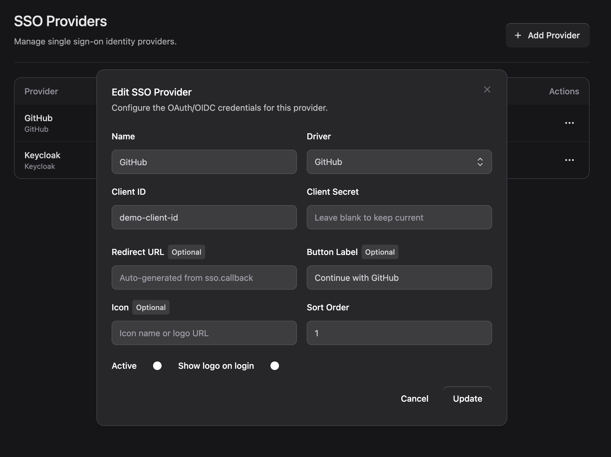

# Admin UI

An optional Livewire + Flux screen to create, edit, enable/disable, and delete providers. It is the
only Flux-dependent surface and is registered only when Livewire is installed.



## Two ways to mount it

**Full-page route** (default) — registered at `config-sso.admin.prefix` (`admin/settings/sso`) with
`config-sso.admin.middleware` (`['web', 'auth']`):

```text
GET /admin/settings/sso   →   route name: config-sso.admin
```

**Embedded** — set `config-sso.admin.route = false` and drop the component into your own page:

```blade
<livewire:config-sso.admin />
```

## Authorization

Before loading, the component checks `config('config-sso.gate')` (default `admin.manage.sso`). Define
that ability in your app:

```php
Gate::define('admin.manage.sso', fn ($user) => $user->is_admin);
```

Set the gate to `null` to disable the check (not recommended in production).

## Layout

The full-page route renders into `config-sso.admin.layout` (default `config-sso::layouts.app`, a
self-contained layout that loads Tailwind, Livewire, and Flux so the route works out of the box).

Point it at your own layout to use your app chrome:

```php
// config/config-sso.php
'admin' => [
    'layout' => 'components.layouts.app',
],
```

Your layout must yield the Livewire slot and include `@livewireStyles`/`@livewireScripts` and
`@fluxAppearance`/`@fluxScripts`.

> **Do not** rely on Livewire's implicit page layout — it 500s with "No hint path defined for
> [layouts]" in apps that don't define it. See
> [patterns](../01-architecture/02-patterns.md#full-page-admin-layout-do-not-regress).

## Icons

The admin view uses Flux icons, which are **Heroicons**. If you customise the published view, use
Heroicon names (`ellipsis-horizontal`, `trash`, `eye-slash`) — Lucide names throw at render time.
