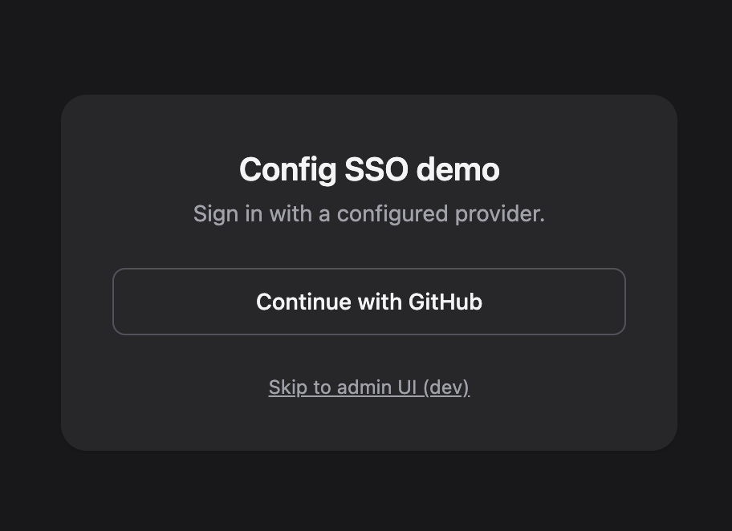

# Laravel Config SSO — Documentation

Database-backed single sign-on (SSO) identity providers for Laravel: store OAuth/OIDC providers
(Google, GitHub, GitLab, Bitbucket, Keycloak, Azure AD) with an **encrypted client secret** and
per-driver config, run a [Laravel Socialite](https://laravel.com/docs/socialite) redirect/callback
flow that finds-or-creates and links the local user, and manage everything from an optional
**Livewire + Flux** admin UI.

> New here? Start with [Getting Started](02-development/01-getting-started.md).

## Contents

| Section | What's inside |
|---|---|
| [01 · Architecture](01-architecture/README.md) | How the package is wired, the design rules that keep it app-agnostic, and the data layer |
| [02 · Development](02-development/README.md) | Installing, the local workbench, contributing workflow, and testing |
| [03 · Configuration](03-configuration/README.md) | Every key in `config/config-sso.php`, with defaults and env vars |
| [04 · API & Usage](04-api/README.md) | The `ConfigSso` facade, auth routes, the `<x-sso />` component, and the admin UI |

## At a glance

- 🔐 DB-backed providers, encrypted `client_secret` and OAuth `token_data`
- 🧩 Core drivers via `laravel/socialite`; Keycloak / Azure via optional `socialiteproviders/*`
- 🖥️ Optional Livewire 4 + Flux admin UI (create / edit / enable / delete)
- 🧱 App-agnostic — configurable user model, table names, and authorization gate
- ✅ Laravel **12 & 13**, PHP **8.2+**, Livewire **3.5 / 4** + Flux **2**

## Screenshots

| Login page (`<x-sso />`) | Admin UI (Livewire + Flux) |
|---|---|
|  |  |
